# ACICP302ICS — Network Security & Attacks

## Final OT / ICS Network Security Practical Assessment Report

| Assessment Detail | Value |
|---|---|
| Programme | Advanced Critical Infrastructure Security |
| Course | ACICP302ICS — Network Security & Attacks |
| Assessment | Controlled OT / ICS Network Security Practical |
| Date | 14 October 2026 |
| Instructor source commit | `2a66f9bcf253eb3fe31c68ad52794cd535421da8` |
| Authorized network scope | `127.0.0.1` |

---

## Executive Summary

This assessment evaluated an instructor-supplied OT simulation using Modbus/TCP, a simulated industrial process, a process-aware validation guard and direct and guarded monitoring interfaces.

All controlled activity remained confined to the local loopback interface `127.0.0.1`.

The principal finding was that direct access to the simulated plant on port `5020` bypassed guard enforcement. During the supplied pressure-hold scenario, the direct path reached `95.0 bar` against a defined safe pressure range of `30.0–40.0 bar`.

The guarded equivalent produced no unsafe observed pressure reading and generated range, step-size and rolling-drift events.

A replay-oriented scenario also demonstrated that the supplied validation design does not implement explicit freshness or anti-replay controls.

The full assessment evidence, including screenshots, packet capture, event logs, risk analysis and recovery verification, is maintained in this GitHub-native submission.

---

## ACICP302ICS — Preflight Record

```text
ACICP302ICS — Activity 00 Preflight Record
==========================================

Timestamp: 2026-10-14T14:41:02+01:00
Lab account: guestvm
Home: /home/guestvm
Course source: /home/guestvm/course/ACICP302ICS-Network-Security-and-Attacks
Canonical runnable source: /home/guestvm/course/ACICP302ICS-Network-Security-and-Attacks/labs/ot-security/student-lab-source
Course commit: 2a66f9bcf253eb3fe31c68ad52794cd535421da8

Python: Python 3.12.3
pymodbus: 3.6.9
Flask: 3.1.3

Authorized scope: 127.0.0.1 only
Unsafe-address source check:
PASS: no prohibited addresses found.

Pre-service port check:
PASS: lab ports 5020, 5021, 8080 and 8081 are unused.

Environment deviation:
Dedicated non-sudo Ubuntu user account used on local Ubuntu host.
This differs from the course guide's fresh isolated VM recommendation.

Simulation services started: NO
Demonstration scripts executed: NO
```

---

## ACICP302ICS — Architecture and Source Record

```text
ACICP302ICS — Activity 01 Source Architecture
==============================================

Course commit: 2a66f9bcf253eb3fe31c68ad52794cd535421da8

=== PLANT ===
16:REG_TEMP = 0
17:REG_PRESSURE = 1
18:REG_FLOW = 2
19:REG_ALARM = 3
21:TEMP_RANGE = (600, 750)
22:PRESSURE_RANGE = (300, 400)
23:FLOW_RANGE = (500, 1500)
25:UPDATE_INTERVAL_SEC = 1.0
26:HOST = "127.0.0.1"
27:PORT = 5020
42:            REG_TEMP: 670,
43:            REG_PRESSURE: 340,
44:            REG_FLOW: 900,
67:        temp = clamp(block.get_internal(REG_TEMP) + random.randint(-2, 2), *TEMP_RANGE)
68:        pressure = clamp(block.get_internal(REG_PRESSURE) + random.randint(-3, 3), *PRESSURE_RANGE)
69:        flow = clamp(block.get_internal(REG_FLOW) + random.randint(-10, 10), *FLOW_RANGE)
71:        block.set_internal(REG_TEMP, temp)
72:        block.set_internal(REG_PRESSURE, pressure)
73:        block.set_internal(REG_FLOW, flow)
75:        store.setValues(3, REG_TEMP, [temp])
76:        store.setValues(3, REG_PRESSURE, [pressure])
77:        store.setValues(3, REG_FLOW, [flow])
79:        alarm = 1 if pressure >= PRESSURE_RANGE[1] - 5 else 0
80:        store.setValues(3, REG_ALARM, [alarm])
86:        time.sleep(UPDATE_INTERVAL_SEC)

=== GUARD ===
19:PLANT_HOST = "127.0.0.1"
20:PLANT_PORT = 5020
22:GUARD_PORT = 5021
24:REG_TEMP = 0
25:REG_PRESSURE = 1
26:REG_FLOW = 2
27:REG_ALARM = 3
29:TEMP_RANGE     = (600, 750)   # tenths of a degree C
30:PRESSURE_RANGE = (300, 400)   # tenths of a bar
31:FLOW_RANGE     = (500, 1500)  # tenths of Nm3/h
33:MAX_TEMP_STEP      = 30
34:MAX_PRESSURE_STEP  = 50
35:MAX_FLOW_STEP       = 100
40:# value from DRIFT_WINDOW writes ago. This catches cumulative creep even
42:DRIFT_WINDOW              = 3   # was 6 — shrinking cuts the attacker's runway in half
43:DRIFT_THRESHOLD_TEMP      = 20  # 2.0C cumulative over the window
44:DRIFT_THRESHOLD_PRESSURE  = 20  # 2.0 bar cumulative over the window
45:DRIFT_THRESHOLD_FLOW      = 40  # 4.0 Nm3/h cumulative over the window
84:        self.temp_accepted_history     = deque(maxlen=DRIFT_WINDOW)
85:        self.pressure_accepted_history = deque(maxlen=DRIFT_WINDOW)
86:        self.flow_accepted_history     = deque(maxlen=DRIFT_WINDOW)
105:        if len(drift_history) == DRIFT_WINDOW:
110:                    f"over last {DRIFT_WINDOW} accepted writes exceeds "
120:        if address == REG_TEMP:
121:            current = self.getValues(3, REG_TEMP, count=1)[0]
122:            reasons = self._check(address, requested, current, TEMP_RANGE,
123:                                   MAX_TEMP_STEP, self.temp_accepted_history,
124:                                   DRIFT_THRESHOLD_TEMP, "C", 10)
125:        elif address == REG_PRESSURE:
126:            current = self.getValues(3, REG_PRESSURE, count=1)[0]
127:            reasons = self._check(address, requested, current, PRESSURE_RANGE,
128:                                   MAX_PRESSURE_STEP, self.pressure_accepted_history,
129:                                   DRIFT_THRESHOLD_PRESSURE, " bar", 10)
130:        elif address == REG_FLOW:
131:            current = self.getValues(3, REG_FLOW, count=1)[0]
132:            reasons = self._check(address, requested, current, FLOW_RANGE,
133:                                   MAX_FLOW_STEP, self.flow_accepted_history,
134:                                   DRIFT_THRESHOLD_FLOW, " Nm3/h", 10)
163:        if address == REG_TEMP:
165:        elif address == REG_PRESSURE:
167:        elif address == REG_FLOW:
187:                    t, p, f = regs[REG_TEMP], regs[REG_PRESSURE], regs[REG_FLOW]
188:                    if (TEMP_RANGE[0]     <= t <= TEMP_RANGE[1] and
189:                        PRESSURE_RANGE[0] <= p <= PRESSURE_RANGE[1] and
190:                        FLOW_RANGE[0]     <= f <= FLOW_RANGE[1]):
201:    plant_client = ModbusTcpClient(PLANT_HOST, port=PLANT_PORT)
217:             HOST, GUARD_PORT, PLANT_HOST, PLANT_PORT)
219:        StartTcpServer(context=context, address=(HOST, GUARD_PORT))

=== DASHBOARDS ===
plant_sim/dashboard.py:6:TARGET_HOST = "127.0.0.1"
plant_sim/dashboard.py:7:TARGET_PORT = 5020
plant_sim/dashboard.py:201:    client = ModbusTcpClient(TARGET_HOST, port=TARGET_PORT)
plant_sim/dashboard.py:224:    app.run(host="127.0.0.1",port=8080)
plant_sim/dashboard_guarded.py:8:TARGET_HOST = "127.0.0.1"
plant_sim/dashboard_guarded.py:9:TARGET_PORT = 5021
plant_sim/dashboard_guarded.py:228:    client = ModbusTcpClient(TARGET_HOST, port=TARGET_PORT)
plant_sim/dashboard_guarded.py:265:    app.run(host="127.0.0.1",port=8081)
```

---

## ACICP302ICS — Verified Modbus Register Map

Course source commit:
2a66f9bcf253eb3fe31c68ad52794cd535421da8

| Register | Variable | Raw safe range | Engineering range | Initial |
|---|---|---|---|---|
| 0 | Electrolyzer temperature | 600-750 | 60.0-75.0 °C | 67.0 °C |
| 1 | Tank pressure | 300-400 | 30.0-40.0 bar | 34.0 bar |
| 2 | H2 flow rate | 500-1500 | 50.0-150.0 Nm3/h | 90.0 Nm3/h |
| 3 | Alarm | 0/1 | Boolean | 0 |

Registers 0-2 use a scale factor of 0.1.

Normal source-defined movement per one-second update:
- Temperature: approximately +/-0.2 °C
- Pressure: approximately +/-0.3 bar
- Flow: approximately +/-1.0 Nm3/h

Plant alarm is asserted when pressure reaches approximately 39.5 bar.

Normal baseline observation:
- Direct dashboard showed approximately 71.9 °C, 30.2 bar and 88.0 Nm3/h.
- Guarded dashboard showed approximately 72.6 °C, 30.1 bar and 89.6 Nm3/h.
- Both dashboards indicated normal/protected operation.
- Guard event view contained no attack events at baseline.

All documented services were bound to 127.0.0.1.

---

## ACICP302ICS — Normal Modbus/TCP Packet Analysis

### Capture

Interface: Linux loopback (`lo`)
Capture filter: `tcp port 5020`
Evidence file: `evidence/packets/normal_modbus.pcapng`
Packets captured: 66
Packets dropped: 0

Only the documented local Modbus plant service on 127.0.0.1:5020 was captured.

### Selected Request / Response

Request frame: 1
Response frame: 2
Transaction Identifier: 669
Unit Identifier: 1
Function Code: 03 — Read Holding Registers

Client:
127.0.0.1:45670

Plant server:
127.0.0.1:5020

Observed request payload:

029d00000006010300000004

Decoded request:
- Transaction ID: 669
- Protocol ID: 0
- Unit ID: 1
- Function Code: 03
- Starting holding register: 0
- Quantity: 4 registers

Observed response payload:

029d0000000b01030802cc015c043b0000

Decoded response:
- Transaction ID: 669
- Function Code: 03
- Byte count: 8
- Register 0: 0x02cc = 716 = 71.6 °C
- Register 1: 0x015c = 348 = 34.8 bar
- Register 2: 0x043b = 1083 = 108.3 Nm3/h
- Register 3: 0x0000 = 0 = alarm off

Observed request-to-response interval was approximately 0.582 ms.

### Interpretation

The captured traffic confirms that the normal dashboard/client reads four consecutive
holding registers beginning at address 0.

The returned values correspond directly to the source-defined process data model:
temperature, pressure, hydrogen flow and alarm status.

Registers 0 through 2 use a scale factor of 0.1. The observed values were within the
source-defined normal ranges and the alarm register was clear.

The request and response remained entirely on 127.0.0.1, consistent with the
authorized loopback-only lab scope.

---

## ACICP302ICS — Local Exposure Record

### Authorized Scope

Observation target: local ACICP302 simulation only

Authorized address:
127.0.0.1

Observation method:
- supplied source-code inspection
- local listener inspection with `ss`
- no general network discovery
- no external network scanning

### Documented Services

| Component | Address | Port | Purpose |
|---|---|---:|---|
| Simulated plant | 127.0.0.1 | 5020 | Direct Modbus/TCP plant path |
| Validation guard | 127.0.0.1 | 5021 | Rule-based guarded Modbus/TCP path |
| Direct dashboard | 127.0.0.1 | 8080 | Direct process visualization |
| Guarded dashboard | 127.0.0.1 | 8081 | Guarded process visualization and event display |

### Observed State

All four services were observed listening only on 127.0.0.1.

No documented ACICP302 service was observed listening on:
- 0.0.0.0
- a LAN address
- an external interface

Evidence:
- E03_Local_Service_Inventory.png
- evidence/logs/normal-service-inventory.md

### Exposure Interpretation

Current loopback-only binding substantially limits exposure from external hosts.

However, source review shows that port 5020 provides a direct path to the simulated plant and does not pass through the validation guard on port 5021.

The dashboards do not implement authentication in the supplied simulation. Their current loopback-only binding reduces exposure, but broader binding would materially increase risk.

This is a source-code-guided educational simulation and is not a production OT security architecture.

---

## ACICP302ICS — Supplied OT Guard Analysis

### Guard Role

The supplied `guard.py` acts as a rule-based Modbus/TCP validation proxy.

Plant:
127.0.0.1:5020

Guard:
127.0.0.1:5021

The guard is an educational control and is not a production process-safety system.

### Decision Table

| Check | Source-defined condition | Action on failure |
|---|---|---|
| Absolute range | Requested value outside allowed process range | Reject write and record event |
| Step-size | Requested change exceeds maximum permitted single step | Reject write and record event |
| Rolling drift | Requested value differs from oldest accepted value in 3-value history by more than drift threshold | Reject write and record event |
| Accepted write | All applicable checks pass | Forward to plant, update local mirror, append accepted history |
| Other register | Address is not temperature, pressure or flow | Pass through without the same process validation |

### Source-defined Thresholds

Temperature:
- Range: 60.0-75.0 °C
- Maximum step: 3.0 °C
- Drift threshold: 2.0 °C

Pressure:
- Range: 30.0-40.0 bar
- Maximum step: 5.0 bar
- Drift threshold: 2.0 bar

Flow:
- Range: 50.0-150.0 Nm3/h
- Maximum step: 10.0 Nm3/h
- Drift threshold: 4.0 Nm3/h

Rolling drift window:
3 accepted values

### Rejection Behaviour

When a protected write fails validation:
- the write is not forwarded to the plant;
- the guard mirror is not updated;
- the rejected value is not added to accepted-history state;
- an event is written to the local event log.

### Safe-State Synchronization

The guard periodically reads registers 0-3 from the real plant.

The mirror is updated only when temperature, pressure and flow are all within their absolute safe ranges.

Therefore the guarded dashboard can retain a last-known-safe state while the direct plant path is abnormal.

### Observed / Source-Derived Limitations

1. Direct access to port 5020 bypasses the guard.
2. No client authentication is implemented.
3. No client authorization policy is implemented.
4. No source/client identity policy is evident.
5. No replay/freshness mechanism is evident.
6. No demonstrated request-rate limiting is implemented.
7. Validation thresholds are process-specific.
8. Other registers are passed through without the same range/step/drift checks.
9. Guarded state can differ from actual direct-plant state during unsafe direct-path conditions.
10. The guard is not a process-safety system.

### Evidence

- `plant_sim/guard.py`
- `E03_Local_Service_Inventory.png`
- `risk-register.md`
- controlled validation evidence to follow

---

## ACICP302ICS — Controlled Security Validation Test Plan

Course commit:
2a66f9bcf253eb3fe31c68ad52794cd535421da8

Canonical source:
labs/ot-security/student-lab-source

Authorized scope:
127.0.0.1 only

### Safety Conditions

- Use only supplied scripts.
- Do not modify script parameters.
- Do not change addresses or ports.
- Run one scenario at a time.
- Establish normal baseline before each scenario.
- Compare direct path 5020 with guarded path 5021.
- Record actual output rather than attempting to force an expected result.
- No DoS demonstration will be performed without explicit instructor approval.

### Scenario 1 — Out-of-range pressure hold

Script:
attack_hold.py

Direct:
python3 attack_hold.py 5020

Guarded:
python3 attack_hold.py 5021

Expected direct-path behaviour:
The supplied out-of-range pressure request may reach the simulated plant.

Expected guarded behaviour:
The guard should reject the request due to absolute-range and/or step-size validation and create event evidence.

Evidence:
- script output
- direct dashboard
- guarded dashboard
- events.jsonl

Recovery:
Wait for normal plant simulation to return to a safe baseline and verify both views before proceeding.

### Scenario 2 — Slow pressure drift

Script:
slow_drift_attack.py

Direct:
python3 slow_drift_attack.py 5020

Guarded:
python3 slow_drift_attack.py 5021

Expected direct-path behaviour:
Incremental supplied pressure writes may influence the direct plant.

Expected guarded behaviour:
Individual writes may initially satisfy step-size rules, but rolling-baseline drift validation is expected to become relevant.

Actual result may vary because normal plant movement occurs concurrently.

Evidence:
- script output
- dashboards
- events.jsonl

Recovery:
Verify normal baseline before proceeding.

### Scenario 3 — Repeated valid pressure write

Script:
replay_attack.py

Direct:
python3 replay_attack.py 5020

Guarded:
python3 replay_attack.py 5021

Expected direct-path behaviour:
The supplied repeated pressure value may be accepted.

Expected guarded behaviour:
If the repeated value remains within range, step and drift thresholds, the guard may accept it because no explicit freshness or anti-replay mechanism is evident.

This scenario is intended to demonstrate a control limitation, not necessarily a guard rejection.

Evidence:
- script output
- dashboards
- events.jsonl

Recovery:
Verify normal baseline after completion.

### Stop Conditions

Stop immediately if:
- any script targets an address other than 127.0.0.1;
- an unexpected service or network destination appears;
- the supplied script differs materially from the reviewed canonical source;
- lab services become unstable outside the expected bounded scenario.

### Instructor Approval

Status:
Not independently evidenced in this record.

The learner must follow the instructor's approval requirements before executing controlled demonstrations.

---

## ACICP302ICS — Scenario 1 Analysis: Out-of-Range Pressure Hold

### Supplied Script

`attack_hold.py`

Authorized target:
`127.0.0.1` only

Direct path:
`127.0.0.1:5020`

Guarded path:
`127.0.0.1:5021`

### Direct-Path Observation

Primary direct execution:

- Writes sent: 75
- Peak pressure observed: 95.0 bar
- Source-defined safe pressure range: 30.0-40.0 bar
- Unsafe readings: 75/75 (100%)
- Script result: `UNSAFE VALUE REACHED THE PLANT`

An inadvertent duplicate direct-path execution also occurred:

- Writes sent: 76
- Peak pressure observed: 95.0 bar
- Unsafe readings: 74/76 (97%)

The first execution is used as the primary direct-path evidence.

### Guarded-Path Observation

- Writes sent: 76
- Peak pressure observed: 37.3 bar
- Unsafe readings: 0/76 (0%)
- Script result: `value never left safe range — attack fully contained`

### Guard Event Evidence

The guard logged repeated rejection reasons including:

- requested pressure 95.0 bar outside the 30.0-40.0 bar safe range;
- approximately 58 bar single-step change exceeding the 5.0 bar maximum;
- approximately 58 bar cumulative drift exceeding the 2.0 bar rolling-drift threshold.

### Interpretation

The direct plant path on port 5020 accepted the supplied out-of-range pressure request and therefore bypassed the validation control.

The same supplied request sent through the guarded path on port 5021 did not produce an unsafe observed pressure.

This validates the source-derived finding that the guard rejects writes that fail its range, step-size and rolling-drift checks.

It also validates the architectural risk that direct access to port 5020 bypasses guard enforcement.

### Recovery

After the direct scenario, all four documented services remained listening on their loopback addresses:

- 127.0.0.1:5020
- 127.0.0.1:5021
- 127.0.0.1:8080
- 127.0.0.1:8081

A normal process baseline must be confirmed before Scenario 2.

---

## ACICP302ICS — Scenario 2 Analysis: Slow Pressure Drift

### Supplied Script

`slow_drift_attack.py`

Direct path:
`127.0.0.1:5020`

Guarded path:
`127.0.0.1:5021`

### Direct-Path Observation

The direct run began at approximately 37.8 bar.

The supplied script incrementally requested higher pressure values, including:

- 38.8 bar -> observed approximately 39.0 bar
- 39.8 bar -> observed approximately 40.0 bar
- 40.8 bar -> observed approximately 40.0 bar
- 41.8 bar -> observed approximately 39.7 bar
- 42.8 bar -> observed approximately 39.7 bar
- later requests continued upward toward approximately 48.8 bar while observed readings remained near the upper safe boundary.

The direct-path result differs from Scenario 1 because the slow-drift script waits between writes. During those intervals, the plant simulation's periodic process-update logic continues running and clamps pressure into its source-defined 30.0-40.0 bar range.

Therefore, the observed safe readback on the direct path does not demonstrate guard protection. It reflects interaction between the supplied write timing and the plant's own simulation/update behaviour.

### Guarded-Path Observation

The guarded run began at approximately 36.7 bar.

Early requests inside the safe range were reflected in process readings.

Examples:

- requested 37.7 bar -> observed approximately 37.8 bar
- requested 38.7 bar -> observed approximately 38.4 bar
- requested 39.7 bar -> observed approximately 39.9 bar

Once requests exceeded the source-defined 40.0 bar pressure limit, observed guarded pressure remained approximately 39-40 bar.

### Guard Event Evidence

The guard recorded:

- 40.7 bar: outside safe range
- 41.7 bar: outside safe range
- 42.7 bar: outside safe range and 3.0 bar cumulative drift
- later requests: increasing cumulative-drift violations
- from 45.7 bar onward: step-size violations also became applicable

The source-defined pressure controls are:

- absolute range: 30.0-40.0 bar
- maximum single step: 5.0 bar
- rolling drift threshold: 2.0 bar
- rolling window: 3 accepted values

### Interpretation

The scenario demonstrates layered guard behaviour.

Absolute-range validation became the first explicit rejection condition once the requested pressure exceeded 40.0 bar.

As rejected writes accumulated while the accepted baseline remained safe, the rolling-baseline drift difference increased and subsequently triggered the drift rule.

At larger requested differences, the single-step rule also became applicable.

The scenario also demonstrates why direct-path readback must be interpreted alongside plant timing. The direct plant's periodic simulation update can normalize pressure before the script reads the value back.

### Evidence

- E07A_SlowDrift_Direct.png
- E07B_SlowDrift_Guarded.png
- evidence/logs/scenario-02-slow-drift.md
- plant_sim/events.jsonl

---

## ACICP302ICS — Scenario 3 Analysis: Replay / Freshness

### Supplied Script

`replay_attack.py`

Authorized target:
127.0.0.1 only

Direct path:
127.0.0.1:5020

Guarded path:
127.0.0.1:5021

### Direct-Path Observation

The direct-path execution replayed the same valid pressure write three times:

32.3 bar

No service failure occurred after the execution.

### Guarded-Path Observation

The guarded-path execution replayed the same valid pressure write three times:

33.2 bar

No new guard event was generated during the replay scenario.

### Interpretation

The guarded replay was not rejected.

This is consistent with the supplied guard design.

The guard validates:
- absolute process range;
- maximum single-step change;
- rolling-baseline drift.

The reviewed source does not implement an explicit:
- freshness check;
- sequence-number policy;
- duplicate-command check;
- anti-replay mechanism.

Because the repeated pressure value remained within the applicable process limits, the same valid value could be accepted repeatedly.

This does not mean the guard failed its implemented controls. Instead, the scenario demonstrates a limitation in the scope of those controls.

A stronger production design could supplement process-value validation with command freshness, authenticated client identity, sequence/session context, or replay-detection logic.

### Evidence

- E08A_Replay_Direct.png
- E08B_Replay_Guarded.png
- plant_sim/events.jsonl

---

## ACICP302ICS — Risk Register

| Risk ID | Source component/process | Observed local exposure/source fact | Potential simulated process impact | Likelihood | Impact | Initial rating | Preventative control | Detective control | Owner | Status | Evidence reference |
| --- | --- | --- | --- | --- | --- | --- | --- | --- | --- | --- | --- |
| R01 | Direct Modbus plant path | Plant listens on 127.0.0.1:5020 and can be accessed without passing through guard port 5021 | Direct writes may bypass validation and influence simulated process values | Medium | High | High | Remove or restrict direct access path; enforce policy through a controlled gateway | Monitor direct-path writes and compare direct vs guarded activity | Lab/System Owner | Open | E03; source plant.py and guard.py |
| R02 | Modbus access control | Supplied simulation does not implement client authentication or authorization for Modbus access | Any local process able to connect to the documented service could attempt reads or writes | Medium | High | High | Apply authentication/authorization at an OT gateway or network control layer | Log and alert on unauthorized or unexpected client activity | Lab/System Owner | Open | Source guard.py |
| R03 | Dashboard services | Direct and guarded dashboards have no login in the supplied simulation | If exposed beyond loopback, process information could be viewed without authentication | Low | Medium | Medium | Keep dashboards loopback-only or require authenticated access before broader exposure | Monitor listener configuration and web access logs | Lab/System Owner | Open | E03; source dashboard.py and dashboard_guarded.py |
| R04 | Writable process registers | Registers 0-2 represent writable process variables in the simulation | Unauthorized writes could change temperature pressure or flow values | Medium | High | High | Validate writes against process rules and restrict write-capable clients | Alert on abnormal writes and process deviations | Lab/System Owner | Open | Register map; source plant.py |
| R05 | Availability | Supplied guard code has no demonstrated rate-limiting control | Excessive local requests could affect service availability or responsiveness | Low | Medium | Medium | Implement request throttling and resource limits | Monitor request rate latency and service health | Lab/System Owner | Open | Source guard.py; validation pending |
| R06 | Guarded-state visibility | Guard mirrors plant values only when temperature pressure and flow remain inside defined safe ranges | Guarded view may retain last-known-safe values while the direct plant path is abnormal | Medium | High | High | Correlate guarded state with independent direct plant health signals | Alert on divergence between direct and guarded process state | Lab/System Owner | Open | Source guard.py |
| R07 | Replay/freshness | Supplied guard validation is based on range step-size and rolling drift; no freshness or anti-replay mechanism is evident | A repeated otherwise-valid write may not be distinguished from a legitimate repeated command | Medium | Medium | Medium | Add sequence freshness session identity or command replay protection | Detect repeated identical commands within policy-defined windows | Lab/System Owner | Open | Source guard.py; controlled validation pending |
| R08 | Register coverage | Guard applies specific validation logic to temperature pressure and flow; other registers are forwarded without the same checks | Unvalidated register access could bypass intended process-specific rules | Low | Medium | Medium | Apply explicit allow-list and validation policy to every writable register | Log all register writes including currently unvalidated addresses | Lab/System Owner | Open | Source guard.py |

---

ACICP302ICS — Final Recovery Verification
==========================================

Timestamp: 2026-10-14T18:38:17+01:00

Port state:
PASS: ports 5020, 5021, 8080 and 8081 are no longer listening.

Process state:
PASS: no supplied ACICP302 lab processes remain.

Environment note:
Lab used a dedicated non-sudo Ubuntu account on the local host rather than a fresh guest VM.
VM snapshot restoration was therefore not applicable.

---

## ACICP302ICS — Evidence Gallery

All visual evidence below was collected from the authorized instructor-supplied local OT simulation.

**Authorized network scope:** `127.0.0.1`

---

### E01 — Preflight and Source Safety

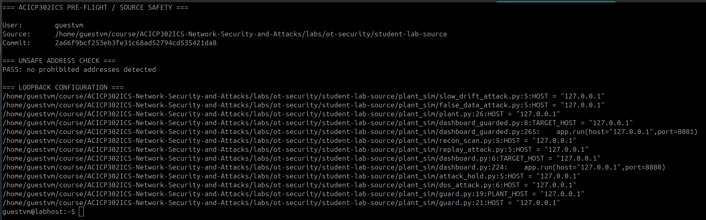

Canonical source, source commit and loopback-only safety verification.

---

### E02 — Normal Operating Baseline

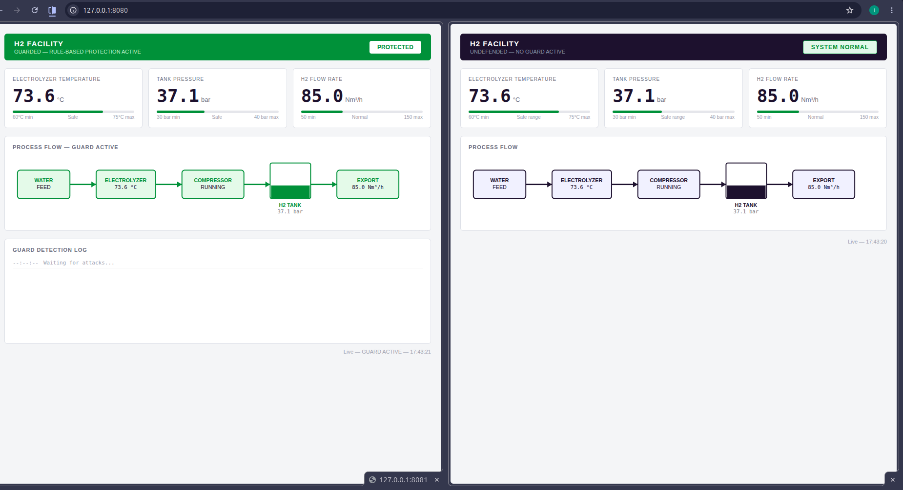

Direct and guarded dashboards during normal process operation.

---

### E03 — Local Service Inventory

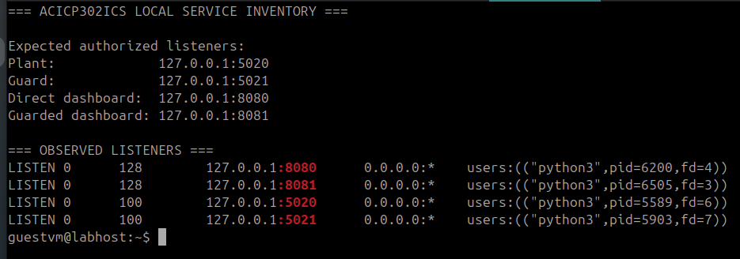

Authorized services listening on 127.0.0.1 only.

---

### E04 — Modbus/TCP Request and Response

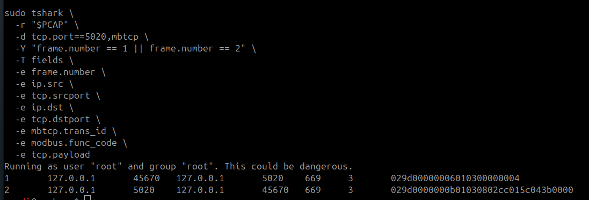

Selected Function Code 03 request/response used for packet analysis.

---

### E05 — Guard Rule Analysis

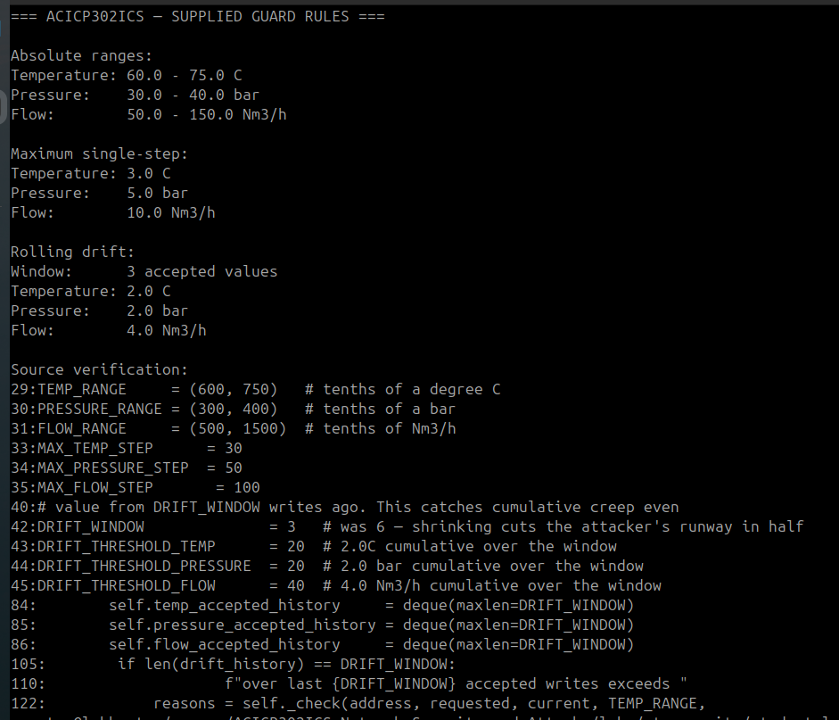

Source-defined absolute-range, maximum-step and rolling-drift controls.

---

### E06A — Attack Hold — Direct Path

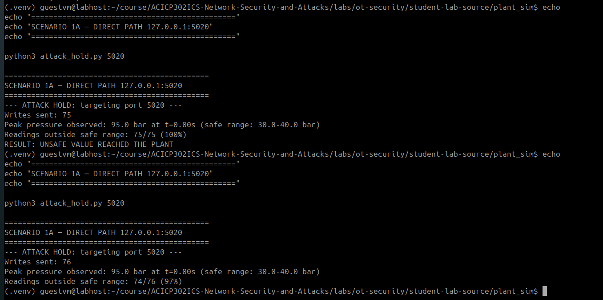

Direct path reaching the supplied 95.0 bar value.

---

### E06B — Attack Hold — Guarded Path

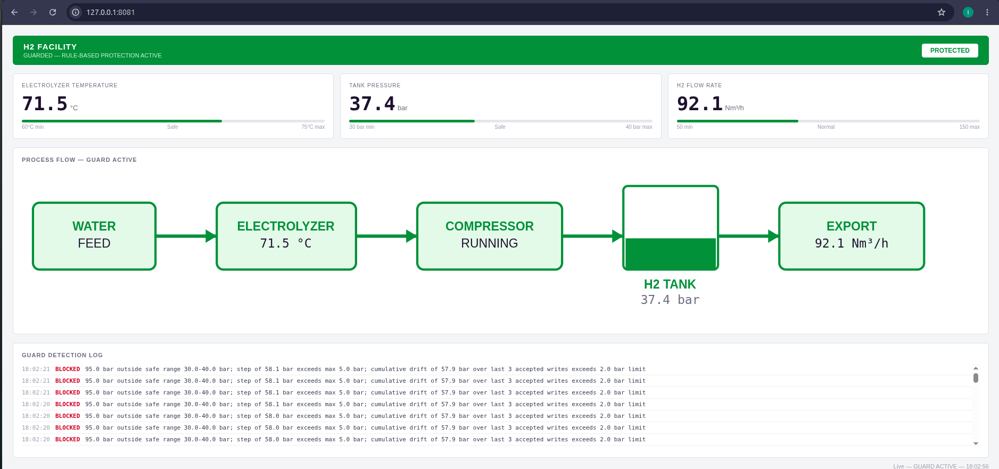

Guarded path containment and detection evidence.

---

### E07A — Slow Drift — Direct Path

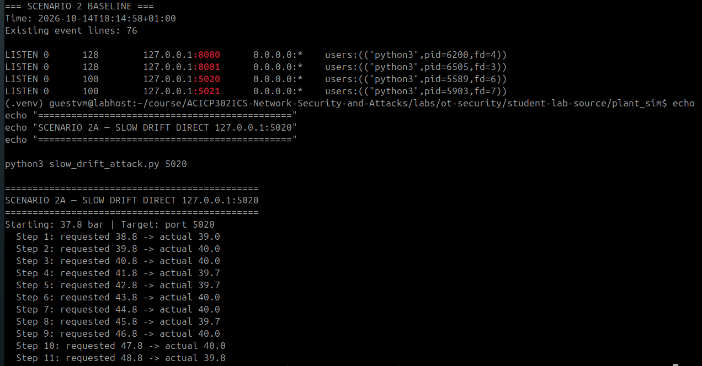

Direct-path slow-pressure-drift observation.

---

### E07B — Slow Drift — Guarded Path

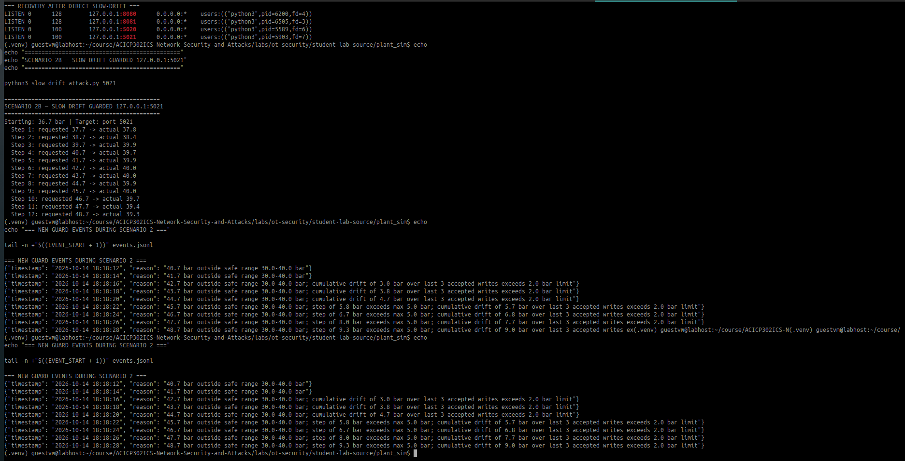

Guard rejection events during the slow-drift scenario.

---

### E08A — Replay — Direct Path

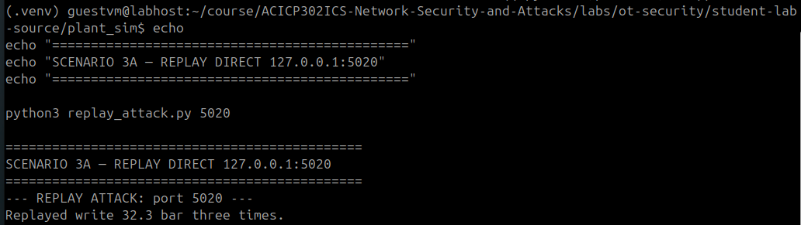

Repeated otherwise-valid direct write.

---

### E08B — Replay — Guarded Path

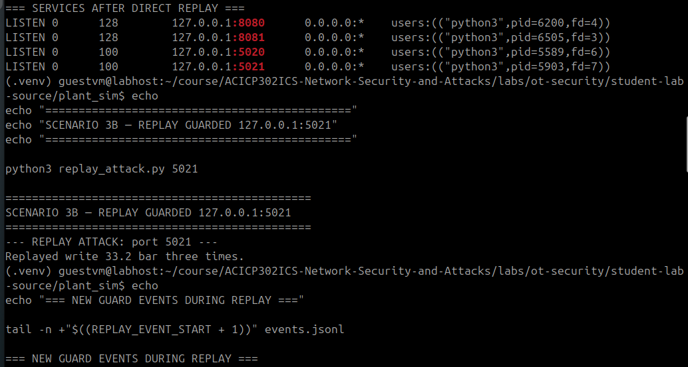

Repeated otherwise-valid guarded write with no new guard event.

---

### E09 — Final Recovery Verification

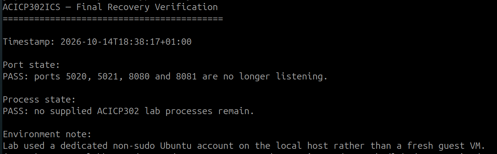

Confirmation that the four laboratory ports were closed and supplied processes stopped.

---

### Additional Evidence

- [Normal Modbus/TCP packet capture](evidence/packets/normal_modbus.pcapng)
- [Final guard event log](evidence/logs/events-final.jsonl)
- [Normal service inventory](evidence/logs/normal-service-inventory.md)
- [Scenario 1 execution log](evidence/logs/scenario-01-attack-hold.md)
- [Scenario 2 execution log](evidence/logs/scenario-02-slow-drift.md)
- [Scenario 3 execution log](evidence/logs/scenario-03-replay.md)

---

## Conclusion

The practical demonstrated both the effectiveness and limitations of process-aware validation in the supplied OT simulation.

The guarded path successfully prevented supplied process writes that violated configured safety rules, while the direct plant interface remained a validation-bypass path.

The exercise also identified limitations including lack of client authentication and authorization, absence of explicit replay protection, and incomplete validation coverage for non-protected registers.

All validation remained inside the authorized loopback simulation, and the laboratory services were successfully stopped and verified during final recovery.
